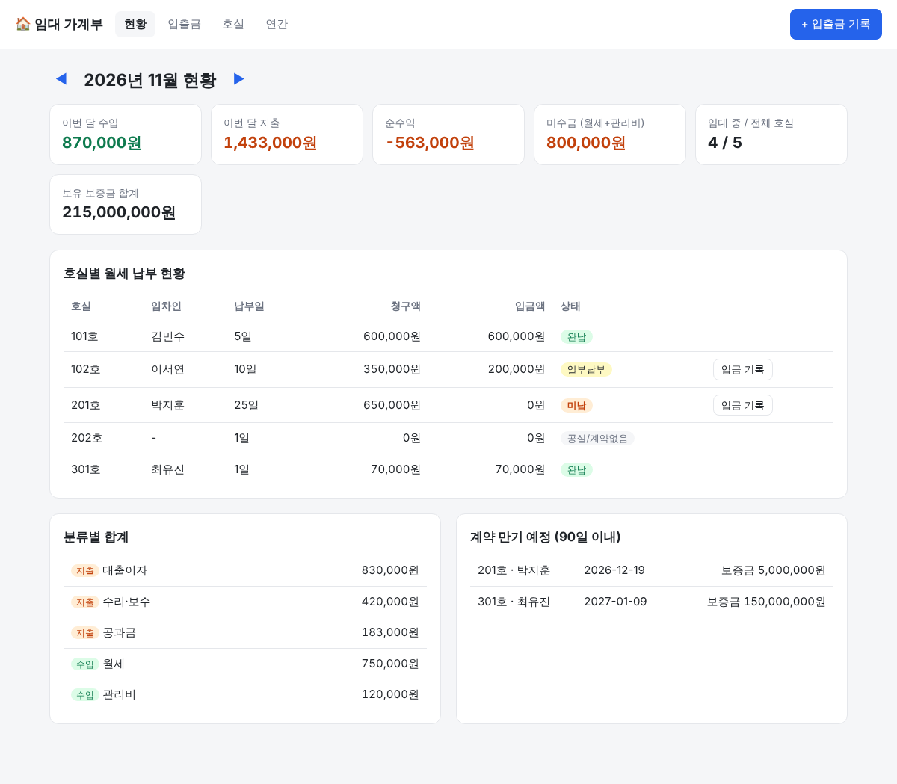

# 🏠 임대 가계부 (다가구 임대 입출금 관리)

다가구 주택의 **호실별 임대 계약**과 **입출금 내역**을 가계부처럼 관리하는 웹 프로그램입니다.
Python(Flask)과 SQLite만 사용해서 설치가 간단합니다.



## 주요 기능

| 화면 | 기능 |
|---|---|
| **현황** | 월별 수입, 지출, 순수익, 미수금, 보유 보증금 합계. 호실별 월세 납부 상태(완납/일부납부/미납), 분류별 합계, 90일 안에 만기되는 계약 |
| **입출금** | 월별 입출금 목록, 호실·수입/지출 필터, 기록 추가·수정·삭제 |
| **호실** | 호실별 임차인, 연락처, 계약 형태(월세/반전세/전세), 보증금, 월세, 관리비, 납부일, 계약 기간 |
| **연간** | 월별 수입·지출 막대 그래프, 호실별 연간 합계 |

- 현황 화면에서 미납 호실의 **[입금 기록]** 버튼을 누르면 호실, 분류, 남은 금액이 미리 채워진 입력 화면이 열립니다.
- 공용 전기·수도, 대출이자처럼 건물 전체에 해당하는 비용은 호실을 **"공통"**으로 기록합니다.
- 금액은 `1,000,000`처럼 쉼표를 넣어 입력해도 됩니다.

### 분류

- **수입**: 월세, 관리비, 보증금 수령, 기타 수입
- **지출**: 보증금 반환, 수리·보수, 공과금, 청소·관리, 세금, 대출이자, 보험료, 중개수수료, 기타 지출

분류는 `app.py` 맨 위의 `INCOME_CATEGORIES`, `EXPENSE_CATEGORIES`에서 바꿀 수 있습니다.

### 납부 상태를 계산하는 방법

해당 월에 그 호실로 기록한 **월세 + 관리비** 수입을 합해서, 호실에 등록한 (월세 + 관리비)와 비교합니다.
임차인이 없거나 그 달이 계약 기간 밖이면 "공실/계약없음"으로 표시하고 청구하지 않습니다.

## 실행 방법

```bash
cd rental_ledger
pip install -r requirements.txt
python app.py
```

브라우저에서 http://127.0.0.1:5000 을 열면 됩니다.

같은 와이파이에 연결된 휴대폰에서도 보려면 `HOST=0.0.0.0 python app.py`로 실행한 다음 `http://<PC의 IP>:5000`으로 접속하세요.
로그인 기능이 없으므로 **인터넷에 그대로 공개하지 마세요.**

### 처음 사용 순서

1. **호실** 메뉴에서 호실을 모두 등록합니다. (예: 101호, 102호, 201호 …) 공실은 임차인을 비워 둡니다.
2. 월세가 들어오거나 비용이 나가면 오른쪽 위 **+ 입출금 기록**으로 기록합니다.
3. **현황**에서 이번 달 미납 호실과 수지를 확인합니다.

### 데이터 저장 위치와 백업

모든 데이터는 `rental_ledger/rental.db` 파일 하나에 저장됩니다. 이 파일만 복사해 두면 백업이 됩니다.
다른 위치에 저장하려면 `RENTAL_DB=/경로/파일.db python app.py`로 실행하세요.
`rental.db`는 개인정보가 들어 있으므로 `.gitignore`로 git에 올라가지 않게 했습니다.

## 테스트

```bash
cd rental_ledger
python -m pytest -q
```

## 파일 구조

```
rental_ledger/
├── app.py              # 서버, DB, 화면별 처리
├── templates/          # HTML 화면
├── static/style.css    # 디자인 (다크 모드, 모바일 지원)
├── test_app.py         # 테스트
└── requirements.txt
```

## 다음에 추가하면 좋은 기능

- 로그인 (인터넷에 공개할 경우 필수)
- 엑셀/CSV 내보내기와 가져오기 (은행 거래내역 불러오기)
- 매월 월세 자동 청구와 미납 알림
- 계약서, 영수증 사진 첨부
- 종합소득세 신고용 임대소득 집계
